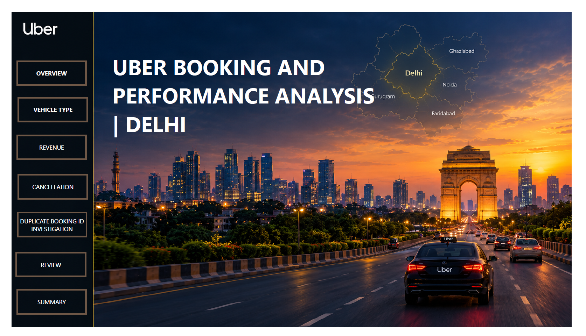
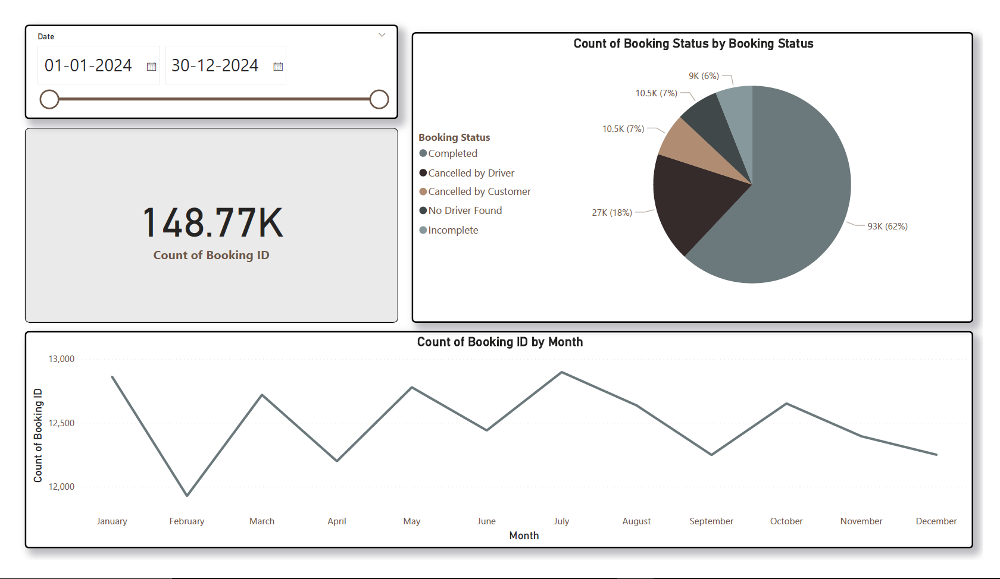
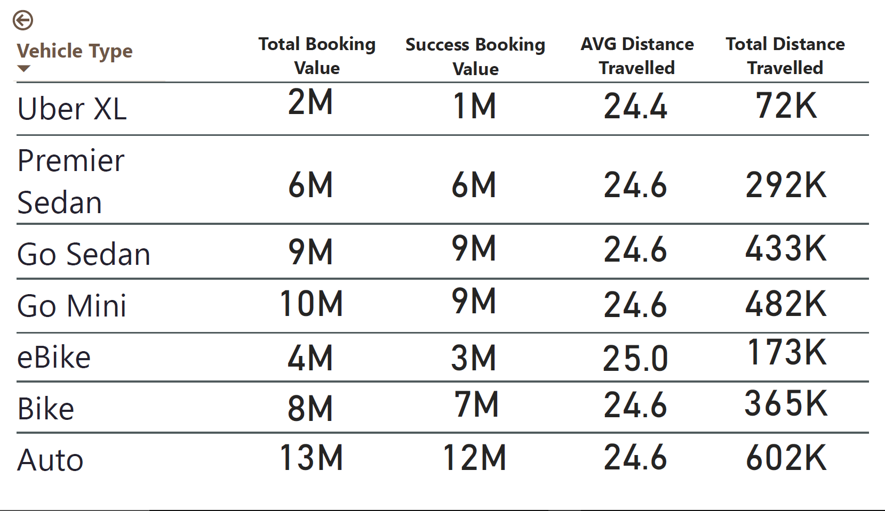
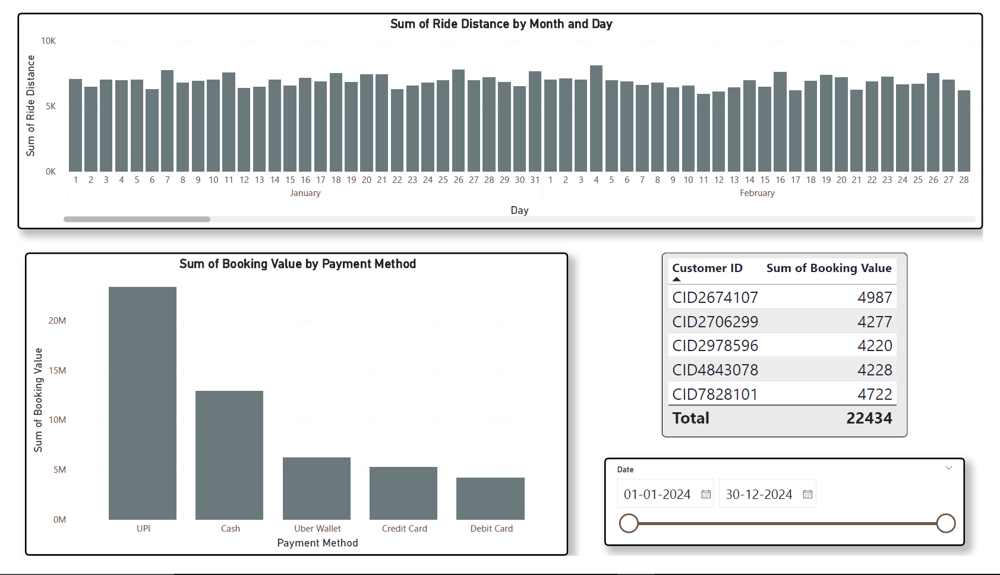
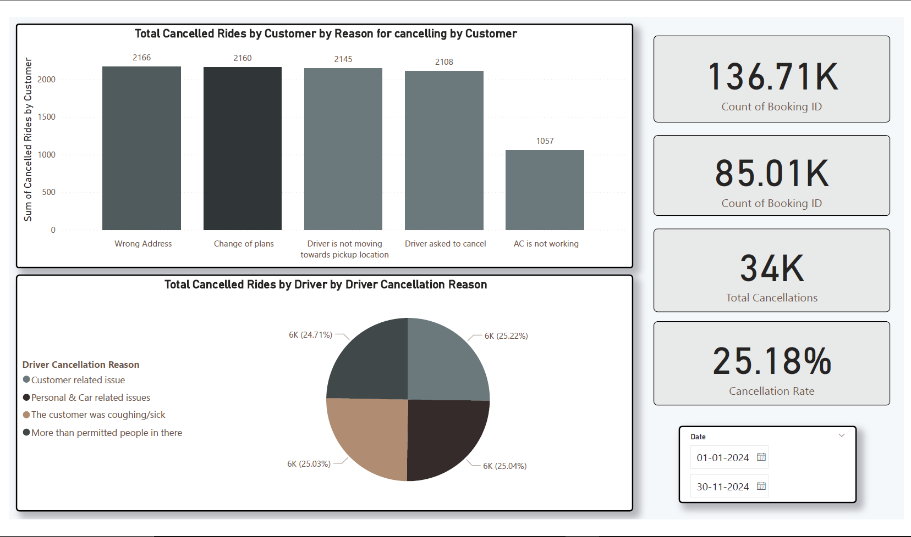
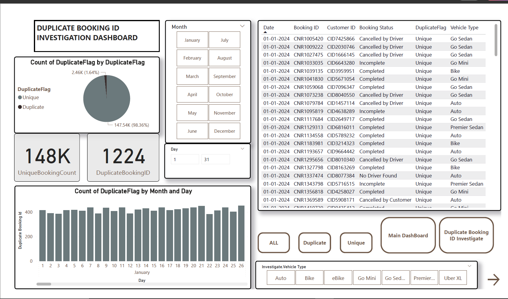
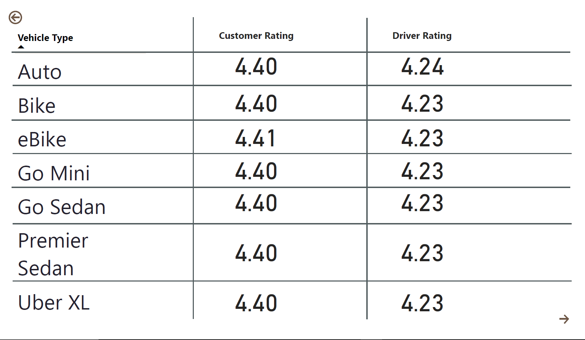
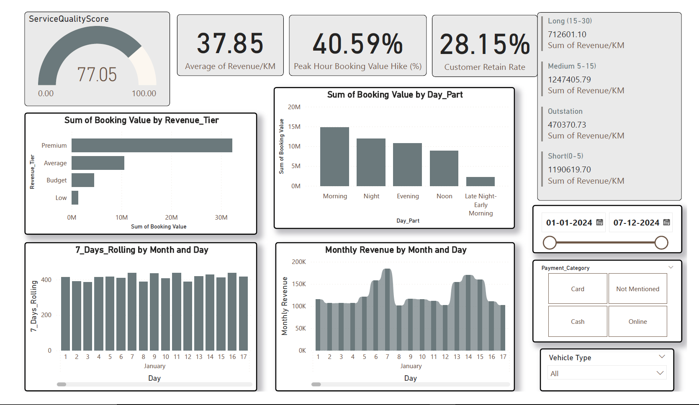

# Uber Booking & Performance Analysis – Delhi | Power BI



## 1. Project Overview

This project focuses on analysing Uber ride-booking operations in Delhi using Microsoft Power BI. The objective is to transform raw booking data into meaningful business insights by examining booking trends, vehicle performance, revenue generation, customer behaviour, cancellation patterns, and service quality.

The project follows an end-to-end Business Intelligence workflow involving data preparation, data modelling, DAX-based KPI development, data-quality investigation, and interactive dashboard development.

The dashboard provides stakeholders with a consolidated view of operational performance and helps identify opportunities to improve booking completion rates, revenue generation, customer retention, and overall service efficiency.

**Project Details**

- **Project Type:** Business Intelligence & Data Analytics
- **Domain:** Ride-Hailing / Transportation Analytics
- **Tools:** Microsoft Power BI, Power Query, DAX
- **Geographical Focus:** Delhi
- **Analysis Period:** January 2024 – December 2024

---

## 2. Business Problem

Ride-hailing platforms generate large volumes of transactional data through daily customer bookings. However, raw booking records alone do not provide sufficient visibility into operational efficiency and business performance.

Several important business questions need to be addressed:

- How many bookings are successfully completed?
- What proportion of bookings are cancelled by customers and drivers?
- Which vehicle categories generate the highest booking value?
- Which payment methods contribute most to revenue?
- How does booking activity change across months and different times of the day?
- What are the major reasons behind customer and driver cancellations?
- Are duplicate booking identifiers affecting the reliability of business reporting?
- How do customer and driver ratings vary across vehicle categories?
- What factors influence revenue performance and customer retention?

This project addresses these questions through an interactive Power BI reporting solution.

---

## 3. Project Objectives

1. **Booking Performance Analysis:** Evaluate total bookings, completed bookings, and booking-status distribution.
2. **Vehicle Performance Analysis:** Compare vehicle categories based on booking value, successful booking value, and distance travelled.
3. **Revenue Analysis:** Examine revenue patterns across payment methods, revenue tiers, and time periods.
4. **Cancellation Analysis:** Identify customer and driver cancellation patterns and their underlying reasons.
5. **Data Quality Investigation:** Detect duplicate Booking IDs and develop a dedicated audit dashboard.
6. **Customer Behaviour Analysis:** Analyse customer retention, booking patterns, and service ratings.
7. **Service Quality Analysis:** Evaluate customer and driver ratings and develop a composite service-quality indicator.
8. **Interactive Reporting:** Build an integrated dashboard with navigation, slicers, KPI cards, and interactive visualisations.

---

## 4. Dashboard Architecture & Walkthrough

The Power BI report consists of eight analytical pages.

### 4.1 Homepage


A dedicated landing page designed to provide intuitive navigation across the analytical sections.

**Features:**
- Custom-designed Uber-themed dashboard interface.
- Navigation buttons for different analytical sections.
- Delhi-themed background and geographical context.
- Structured navigation for an improved reporting experience.

### 4.2 Booking Overview



Provides a high-level understanding of overall booking performance and booking-status distribution.

**Key Visualisations:**
- Total Booking ID KPI.
- Booking-status distribution.
- Monthly booking trends.
- Date-range slicer.

**Key Observations:**
- Approximately 148.77K booking records.
- 93K completed bookings, representing approximately 62%.
- 27K bookings cancelled by drivers, representing approximately 18%.
- 10.5K bookings cancelled by customers, representing approximately 7%.
- Approximately 10.5K bookings with no driver found.
- Approximately 9K incomplete bookings.

**Business Relevance:** Helps stakeholders monitor booking completion performance and understand the contribution of different booking statuses.

### 4.3 Vehicle Type Analysis



Evaluates the operational and financial performance of different vehicle categories.

**Vehicle Categories Analysed:**
- Auto
- Bike
- eBike
- Go Mini
- Go Sedan
- Premier Sedan
- Uber XL

**Key Metrics:**
- Total Booking Value.
- Successful Booking Value.
- Average Distance Travelled.
- Total Distance Travelled.

**Key Observations:**
- Auto generated approximately 13M in total booking value.
- Go Mini generated approximately 10M.
- Go Sedan generated approximately 9M.
- Bike generated approximately 8M.
- Premier Sedan generated approximately 6M.

**Business Relevance:** Helps identify high-performing vehicle categories and compare their contribution to overall business activity.

### 4.4 Revenue Analysis



Examines revenue generation patterns and customer booking behaviour using financial and operational indicators.

**Key Visualisations:**
- Revenue by revenue tier.
- Booking value by time of day.
- Seven-day rolling booking activity.
- Monthly revenue trends.
- Revenue by customer.
- Date, payment category, and vehicle-type filters.

**Key KPIs Displayed:**

| KPI | Value |
|---|---:|
| Service Quality Score | 77.05 |
| Average Revenue/KM | 37.85 |
| Peak Hour Booking Value Hike | 40.59% |
| Customer Retain Rate | 28.15% |

**Key Observations:**
- Premium bookings contribute the largest share of booking value among the displayed revenue tiers.
- Morning bookings contribute the highest booking value among the displayed time-of-day categories.
- UPI contributes the highest booking value among the displayed payment methods.
- Revenue performance varies across different customer segments and time periods.

**Business Relevance:** Provides insights into revenue concentration, customer behaviour, and potential opportunities for improving revenue performance.

### 4.5 Cancellation Analysis



Investigates booking cancellations from both customer and driver perspectives.

**Customer Cancellation Reasons Analysed:**
- Wrong address.
- Change of plans.
- Driver not moving towards pickup location.
- Driver asked to cancel.
- AC is not working.

**Driver Cancellation Reasons Analysed:**
- Customer-related issues.
- Personal and car-related issues.
- Customer coughing or sickness.
- More passengers than permitted.

**Key KPIs Displayed:**
- Total booking count.
- Total cancellations.
- Cancellation rate.
- Customer cancellation distribution.
- Driver cancellation distribution.

**Key Observations:**
- The displayed cancellation rate is approximately 25.18%.
- Wrong address and change of plans are among the prominent customer cancellation reasons.
- Driver cancellation reasons are distributed across several categories.

**Business Relevance:** Helps identify recurring cancellation patterns and potential operational improvements in pickup coordination, customer communication, and driver management.

### 4.6 Duplicate Booking ID Investigation



A dedicated data-quality investigation dashboard designed to identify and analyse duplicate booking identifiers.

Rather than relying exclusively on the primary performance dashboard, this page provides a separate analytical view of duplicate records.

**Key Components:**
- Unique Booking Count.
- Duplicate Booking ID KPI.
- Unique versus duplicate record distribution.
- Duplicate record analysis by month and day.
- Detailed booking-level audit table.
- Month, day, and vehicle-type filters.

**Key Observations:**
- Approximately 147.54K records are classified as unique (98.36%).
- Approximately 2.46K records are classified as duplicate (1.64%) in the displayed distribution.
- The DuplicateBookingID KPI displays 1,224.

**Business Relevance:** Helps investigate repeated booking identifiers, improve data reliability, and prevent potentially misleading business reporting.

### 4.7 Customer & Driver Review Analysis



Evaluates customer and driver ratings across different vehicle categories.

**Key Metrics:**
- Average Customer Rating.
- Average Driver Rating.
- Vehicle-wise rating comparison.

**Key Observations:**
- Average customer ratings are approximately 4.40–4.41 across the displayed vehicle categories.
- Average driver ratings are approximately 4.23–4.24.
- Customer ratings are marginally higher than driver ratings across the displayed categories.

**Business Relevance:** Provides visibility into service experience and helps compare customer and driver feedback across vehicle categories.

### 4.8 Summary Dashboard



A consolidated reporting page bringing together important business indicators and operational insights.

**Key Components:**
- Service Quality Score.
- Average Revenue per KM.
- Peak-hour booking value comparison.
- Customer retention rate.
- Revenue by tier.
- Booking value by time of day.
- Rolling booking activity.
- Monthly revenue trends.
- Vehicle and payment-category filters.

**Business Relevance:** Enables stakeholders to review important performance indicators from a single interface and explore different dimensions of business performance.

---

## 5. Data Preparation & Transformation

Power Query was used to prepare the underlying booking data for analysis.

The preparation workflow focused on improving data consistency and creating meaningful analytical attributes.

**Key Preparation Activities:**

- Reviewing source columns and data types.
- Handling missing and inconsistent values where required.
- Identifying duplicate Booking IDs.
- Creating a separate duplicate-record audit table.
- Preparing date-related attributes for time-based analysis.
- Developing categorical fields for analytical segmentation.
- Creating revenue tiers.
- Deriving day-part and time-based classifications.
- Preparing customer and driver cancellation categories.
- Organising data for interactive reporting.

### Data Quality Investigation

A separate duplicate Booking ID audit was incorporated into the report to make data-quality issues visible to business stakeholders.

This provides a distinction between operational performance analysis and record-level data validation.

---

## 6. Data Modelling & DAX

DAX was used to develop calculated measures and business KPIs that support the analytical requirements of the report.

### Major KPI Categories

**Booking Performance**
- Total Booking Count.
- Unique Booking Count.
- Booking Status Distribution.
- Successful Booking Value.

**Cancellation Analysis**
- Total Cancellations.
- Customer Cancellation Metrics.
- Driver Cancellation Metrics.
- Cancellation Rate.

**Revenue Analysis**
- Total Booking Value.
- Average Revenue per KM.
- Revenue by Tier.
- Peak Hour Booking Value Hike.
- Monthly Revenue.

**Customer & Service Analysis**
- Customer Retain Rate.
- Customer Rating.
- Driver Rating.
- Service Quality Score.

**Data Quality**
- Duplicate Booking ID.
- Unique Booking Count.
- Duplicate Record Distribution.

These measures support interactive calculations and allow the report to respond to user selections and filters.

---

## 7. Technology Stack

| Technology | Application |
|---|---|
| Microsoft Power BI Desktop | Dashboard development and reporting |
| Power Query (M) | Data cleaning and transformation |
| DAX | Calculated measures and KPI development |
| Data Modelling | Organising analytical tables and relationships |
| Power BI Visuals | Interactive charts, tables, KPI cards, and slicers |

---

## 8. Key Business Insights

The analysis highlights several important observations:

1. **Booking Completion:** Approximately 62% of displayed bookings were completed, indicating scope for improving booking conversion and operational reliability.
2. **Cancellation Management:** Driver cancellations account for a significant proportion of bookings, making driver-side operational improvements an important area of focus.
3. **Vehicle Performance:** Auto and Go Mini contribute substantially to the total booking value among the displayed vehicle categories.
4. **Revenue Concentration:** Premium bookings contribute the largest booking value among the displayed revenue tiers.
5. **Payment Behaviour:** UPI is the leading payment method by booking value in the displayed analysis.
6. **Peak-Hour Opportunity:** The dashboard indicates a 40.59% peak-hour booking value hike, suggesting the importance of time-based pricing and capacity planning analysis.
7. **Customer Retention:** The displayed customer retention rate is 28.15%, providing an opportunity to investigate repeat-booking behaviour.
8. **Data Quality:** Duplicate booking records account for approximately 1.64% of the displayed record distribution and warrant further investigation.
9. **Service Quality:** The composite Service Quality Score is 77.05, providing a consolidated indicator for monitoring service performance.

*Note: These observations are based on the displayed dashboard values and should be interpreted alongside the underlying measure definitions and dataset.*

---

## 9. Repository Structure

```text
Uber-Booking-Performance-Analysis/
│
├── Report/
│   └── taxi_project.pbit
│
├── images/
│   ├── homepage.png
│   ├── overview.png
│   ├── vehicle_type.png
│   ├── revenue.png
│   ├── cancellation.png
│   ├── duplicate_booking.png
│   ├── reviews.png
│   └── summary.png
│
└── README.md
```

---

## 10. How to Access the Project

### Prerequisites

- Microsoft Power BI Desktop.
- Access to the underlying dataset and its source, if required by the template.

### Steps

1. Clone this repository:

```bash
git clone https://github.com/USERNAME/REPOSITORY.git
```

2. Navigate to the project directory.

3. Open the following file using Power BI Desktop:

```text
Report/taxi_project.pbit
```

4. Configure the required data source if prompted.
5. Refresh the dataset to populate the report.
6. Explore the eight dashboard pages using the interactive navigation and filters.

**Important:** This repository contains a Power BI Template (`.pbit`). Unlike a `.pbix` file, a `.pbit` does not contain the imported dataset. The underlying data source may be required to populate the report.

---

## 11. Project Learning Outcomes

Through this project, I gained practical experience in:

- Developing end-to-end Business Intelligence solutions.
- Transforming raw transactional data using Power Query.
- Building analytical measures using DAX.
- Designing interactive dashboards with multiple report pages.
- Investigating duplicate records and data-quality issues.
- Translating operational metrics into business insights.
- Developing KPI-driven reporting solutions.
- Structuring dashboards for business stakeholders.

---

## 12. Future Enhancements

Potential improvements to the project include:

- Incorporating predictive models for booking demand forecasting.
- Developing cancellation prediction models.
- Performing deeper customer segmentation and cohort analysis.
- Adding geographical hotspot analysis using pickup and drop locations.
- Developing driver utilisation and availability metrics.
- Implementing automated data refresh and reporting pipelines.

---

## Author

**Dhritiman Keot**

M.Tech – Operations Research  
National Institute of Technology, Durgapur

**Project Focus:** Business Intelligence | Data Analytics | Power BI

---

*If you find this project interesting, feel free to explore the dashboards and share your feedback.*